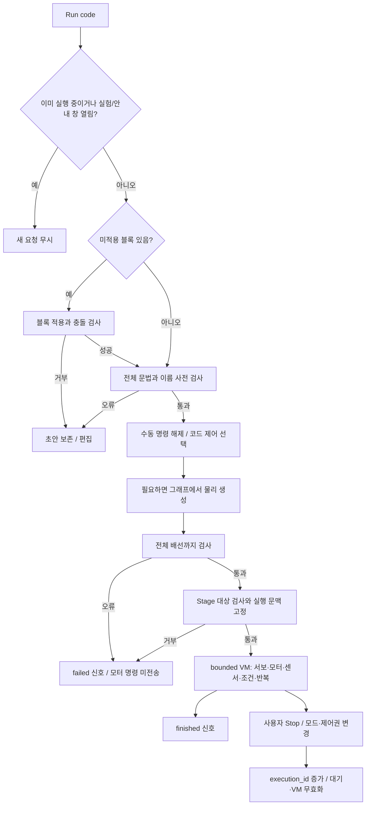
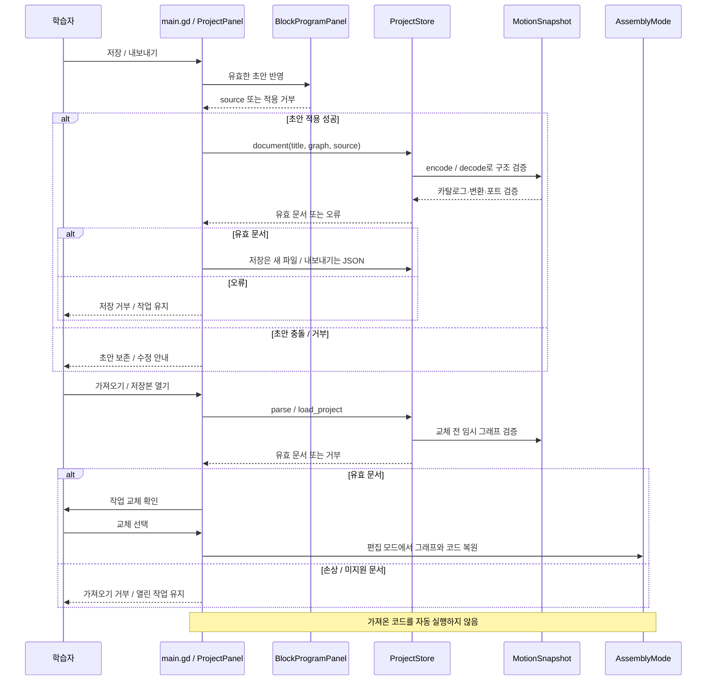
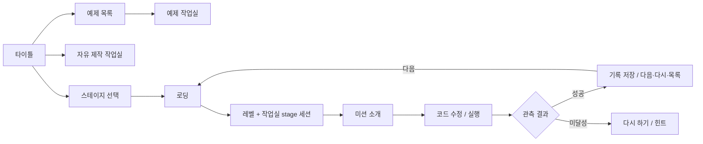
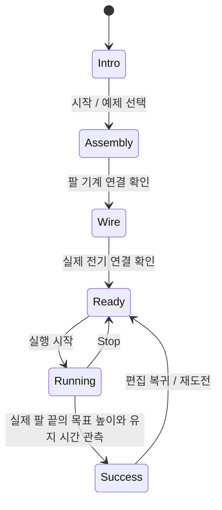
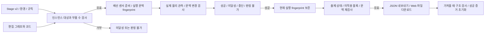

# 실행과 저장 흐름

아래 도식은 [STATUS](STATUS.md)의 통합 소스에 있는 책임과 흐름을 요약해요.

## 코드 실행과 제어권

`scenes/main.gd`가 실행 버튼과 제어권을 조정하고 `MiniRuntime`이 명령을 해석해요. 코드 종료와 임무 성공은 다른 사건이에요. Stop은 VM을 중단하고 DC 모터를 정지하고 LED를 끄며 서보의 마지막 목표를 유지해요. 진행 중 Stage 시도는 cancelled로 기록해요. 물리 정지나 초기 자세 복원으로 해석하지 않아요. 편집 모드 복귀는 `RunMode.teardown()` 뒤 원본 그래프를 다시 보여줘요.

VM은 틱당 128개 연산과 실행 전체 10,000회 루프 진입, 시뮬레이션/실시간 각 60초를
제한해요. `for range`의 경계는 진입할 때 한 번만 계산하고 리스트를 만들지 않아요.
한계 초과는 실패로 전달하고 DC 모터를 제동하고 LED를 꺼요. 반복 중 Stop은 기존 실행 ID 규칙으로
취소해요. 수동 힌지는 그래프 회전 링크에서 제한 관절만 생성하며 서보 매핑에 넣지 않아요.

B-2에서 `LineSensor(pin).value()/is_dark()`는 아래 방향 실제 레이와 표면 재질의 밝기를
읽어요(0=검정, 1023=흰색, 경계 512; 보드 공통). `Button(pin).is_pressed()`는 버튼 전면
충돌만 읽고, 해제 디바운스는 50 ms예요. `LED(pin).on()/off()/set(0..1)`은 인스턴스별
발광 재질을 바꾸며 Stop 뒤 이전 VM 작업이 다시 켜지지 않아요. 새 장치도 전체 소스의
그래프 배선 사전 검사와 기존 블록 왕복 경로를 써요. 기어는 API 없이 물리 구속으로 작동해요.
`cup_object_count()`는 컵 방향·내부 경계에 든 자유 물체를 관측하는 런타임 함수이며
Stage 규칙 연결은 별도 작업이에요. [B-2 검증](evidence/parts_pack_v1_2026-10-22/README.md).

## 로컬 초안의 카메라·행동 제어권

`main.gd._build_agent_tools()`가 `AgentCameraLoop`, Claude 작성 `AgentTracePanel`, 선택적
`AgentDesktopBridge`를 연결해요. AI Enable은 기존 VM/수동/동작 프로그램을 멈춘 뒤 그래프의
차 몸체와 배선 모터 두 개를 확인해요. 물리 정지 확인 → 실제 렌더 캡처 → ready → 현재 프레임에
묶인 유한 행동 → 브레이크 → 실제 정지 확인 순서이며, 다음 행동 전에 다시 관측해요.
프레임은 episode/body instance/revision/generation과 PNG 해시에 묶여요. 에디터 카메라는 입력이 아니에요.
AI가 판단하는 동안에는 실제 바퀴 속도를 피드백한 제한 PI 브레이크가 기존 배선 모터로
느린 밀림을 억제해요. 모터 토크·몸체 위치·물리 시간은 바꾸지 않아요. 카메라 준비 조건은
12틱 연속 차체 속도≤0.001m/s·바퀴≤0.05rad/s로 강화했고, 독립 성공 판정 기준은 유지해요.
Stop/문맥 변경은 이 브레이크 제어도 해제하고 기존 zero-duty 정지로 돌아가요.

로컬 Stop, 코드 실행, 그래프/소스/모드 변경, 주요 대화창 열기, 타임아웃과 pending 연결 끊김은
generation을 바꾸고 기존 명령을 폐기해요. Stop은 앱의 `_on_stop_pressed()`를 공유해요.
전체 물리 일시정지나 몸체 위치 덮어쓰기를 하지 않아요. 외부 CLI/MCP는 이 열린 데스크톱에만
접속하고 앱은 제공자 모델을 호출하지 않아요. 기존 코드 실행·저장·Stage 판정 도식의 책임은 유지해요.
계약과 검증은 [APP_CONTROL_API](APP_CONTROL_API.md), [ADR 0029](adr/0029-rendered-desktop-agent-camera-loop.md)예요.

외부 `run_goal.py`는 기존 Codex ChatGPT 로그인으로 요청 모델 Astra를 MCP에 직접 연결해요.
`observe(PNG) → decide(해시·공개 요약·유한 행동) → 실측 정지 → observe`를 한도 안에서 반복하고
마지막 재관측 뒤 Stop으로 끝내요. `DesktopGoalSession`이 episode/revision/generation을 고정하고
영상·행동·시간 한도를 검사하며 실행 오류/EOF는 닫힌 세션으로 끝내요. 실행기는 별도 읽기 전용
describe 연결로 사람 Stop을 감시해요. 감시 요청이 먼저 도착했을 때 작은 AI 요청 한 개를 최대5초
별도 대기시킨 뒤 일반 검증 경로에서 한 번 실행해요. 실행 중인 작업에는 busy로 응답하며,
대기 요청은 Stop 전용 통신 경로를 차지하지 않아요. Stop 뒤에는 이전 문맥 검사가 거절해요.
실행기·MCP 세션의 종료 정리는 같은 episode/revision/generation을 가진 제어권에만 Stop을 보내요.
앱이 이미 다른 문맥이면 새 실행을 그대로 두고 이전 제어권 해제를 확인해요. 첫 관측 요청 전에
문맥을 고정하며 아직 고정하지 않은 세션 종료는 앱을 중단하지 않아요. 수동 Stop은 전체 중단이에요.
이전 코드/저장/Stage 도식의 호출은 바뀌지 않았어요.

후속 로컬 초안에서는 명시적으로 켠 `run_operator.py`가 연결된 동안 AI 탭의 목표 Run 클릭을
`AgentGoalInbox`에 한 번 큐잉해요. 앱이 코드/수동 제어를 종료하고 새 카메라 episode를 만든 뒤
목표와 revision/generation을 고정해요. ready일 때 operator_poll이 한 번 claim하며 부모·실행기
사전 검사·첫 MCP 영상부터 같은 문맥을 검사해요. Stop→Enable 사이에 남은 목표가 새 실행으로
넘어가지 않아요. Stop/fault/문맥 변경은 즉시 큐를 지워요. 제공자 호출은 계속 외부 foreground이고
한 작업 뒤 종료해요. Web/Stage 도식과 프로젝트 저장에는 operator/목표/로그인을 넣지 않아요.

## 저장과 가져오기

각 화살표는 책임 간 논리 호출을 요약해요. 거부 경로에서는 이후 저장/교체 호출을 하지 않아요. 저장 중인 그래프는 편집 원본이며 현재 강체 위치가 아니에요.

## 화면 흐름과 스테이지 레벨

[app.gd](../scenes/app.gd)가 화면을 바꿔요. 메뉴는 `scenes/screens/`의 2D 씬이고 할 일만 고르게 해요. 선택하면 매번 새 `main.tscn`을 `session`과 함께 만들어요. `stage` 세션은 [StageLevels](../src/core/stage_levels.gd)의 레벨 씬(`stages/<id>/level.tscn`)으로 기본 바닥을 바꾸고, 그 스테이지에 필요한 탭·부품만 보여줘요. 프로젝트·AI 실험실·예제·출제·물리 토글·옛 깃발 패널은 숨겨요. [StageHud](../src/ui/stage_hud.gd)가 미션 소개, 목표 카드의 실시간 측정값, 결과 창을 맡아요. `lab`은 스테이지 선택기와 예제를 숨기고 출제는 남겨요. `example`은 출제를 숨겨요. 세션이 없으면 기존 전체 작업실 그대로예요. 웹에서 `?ssok_workshop=1`이나 `?ssok_verify=1`로 열면 메뉴 없이 전체 작업실이 바로 떠요(브라우저 검사용). 레벨 씬은 [make_levels.gd](../tools/godot/make_levels.gd)로 만들고 에디터에서 다듬어도 돼요. 결정은 [ADR 0028](adr/0028-game-screen-flow-and-stage-levels.md)이에요.

## 깃발 임무

이것은 대표 경로예요. 그래프를 관찰해 기계 연결이 없어지면 Assembly, 배선이 없어지면 Wire로 돌아가는 경로가 모든 관련 상태에 추가돼요. 실제 전이는 [FlagMission._build_chart](../src/ui/flag_mission.gd), 실제 판정은 `_observed_flag_raised()`를 확인해요. 정확한 높이·유지 조건은 [FLAG_MISSION](FLAG_MISSION.md)에 있어요. 깃발 완료가 학습 효과나 다른 로봇의 성공을 인증하지 않아요. 세션 작업실에서는 옛 깃발 패널을 숨기고 깃발 시각물(`show_visual`)은 깃발 스테이지에서만 켜요.

## Stage 판정과 공유

목표·그래프·코드·센서 조건 변경은 이전 성공 증거를 무효화해요. 편집 모드 복귀만으로 성공 증거를 지우지는 않아요. Stage의 센서는 학습 코드가 직접 읽지 않아도 그래프 배선에서 준비한 뒤 실행 문맥을 고정해요. 누락·중복·교체 대상, 센서/물리 오류는 판정 불가, 시간초과·프로그램 오류는 미달성, 사용자 중단은 cancelled예요. 종료한 시도의 늦은 결과는 적용하지 않아요. 범위 밖 초음파는 null 관측으로 계속 실행해요.

규칙은 선언형 수치이며 임의 판정 코드를 실행하지 않아요. 코드 종료 후에도 물리 목표 관측은 가장 긴 유지 시간 + 1.5초 동안 계속되고, 그때까지 목표에 닿지 않으면 `not_met`/`program_finished`로 끝나요(스테이지 세션, ADR 0028). 프로그램 오류/중단은 시도를 종료해요. 실패 이유와 복구 행동은 과제 패널과 공통 상태 표시줄에 나타나요. 서버 공유·계정·검증 서명은 미구현이에요. [계약 상세](STAGE_CONTRACTS.md)를 함께 읽어요.

## 소스와 확인할 검사

[main.gd](../scenes/main.gd), [MiniRuntime](../src/runtime/mini_runtime.gd), [RunMode](../src/runtime/run_mode.gd), [BlockProgramPanel](../src/ui/block_program_panel.gd), [ProjectPanel](../src/ui/project_panel.gd), [FlagMission](../src/ui/flag_mission.gd)가 근거예요. 검사는 [core_authoring](../tests/core_authoring_check.gd), [control_flow](../tests/control_flow_check.gd), [flag_mission](../tests/flag_mission_check.gd)를 작업 범위에 맞춰 실행해요. Stage 관련 검사는 `stage_contract_check`, `stage_authoring_check`, `stage_ui_check`, `sonar_stage_check`, 화면 흐름은 `game_flow_check`예요. 실제 통합 결과는 [증거](evidence/merge_2026-09-30/README.md)에 기록해요.

## 설정과 언어 전환

톱니바퀴 → 수동 입력 중립화·조립/카메라 입력 정지 → 설정 창 → 검증된 선호 변경 → 공유 Theme/기존 override 갱신 → 로컬 저장·결과 안내 → Esc/닫기 → 수동 입력 사용 가능 상태 복원·톱니바퀴 포커스 복귀예요. 실행 VM과 물리는 유지해요. 언어는 원문 키를 가진 기존 컨트롤을 다시 번역하며 블록 카드를 재생성하지 않아요. 화면 글자와 코드 글자 배율은 독립적이에요. [설정 계약](INTERFACE_PREFERENCES.md)과 ADR 0026을 함께 확인해요. 기존 실행·Stop·깃발 상태 전이는 그대로예요.
