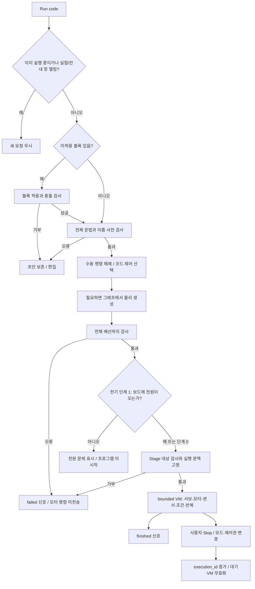
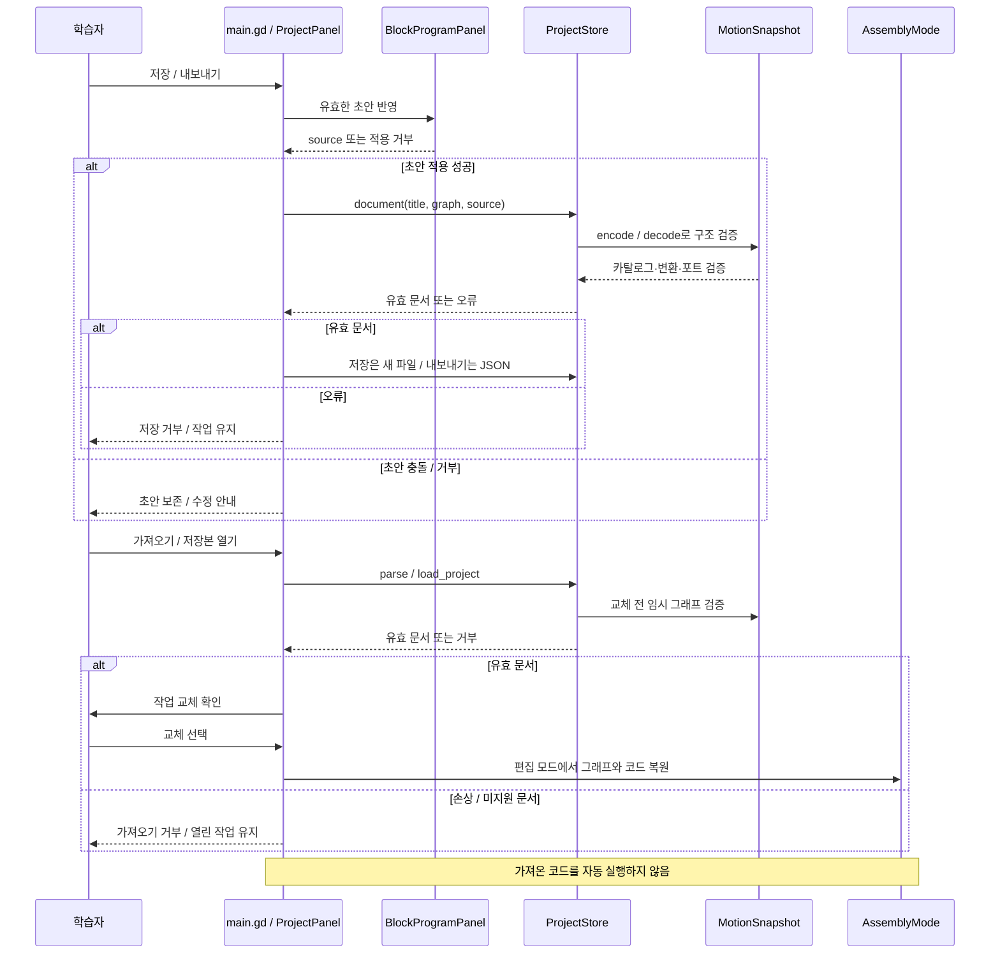
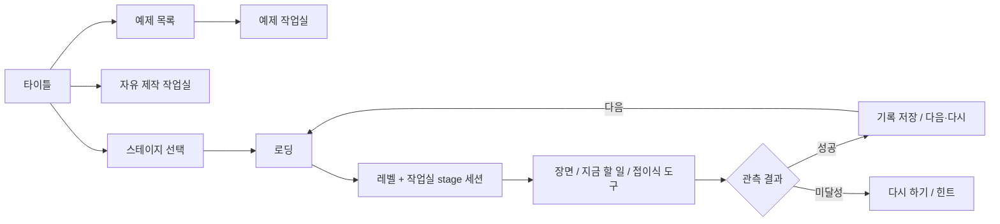
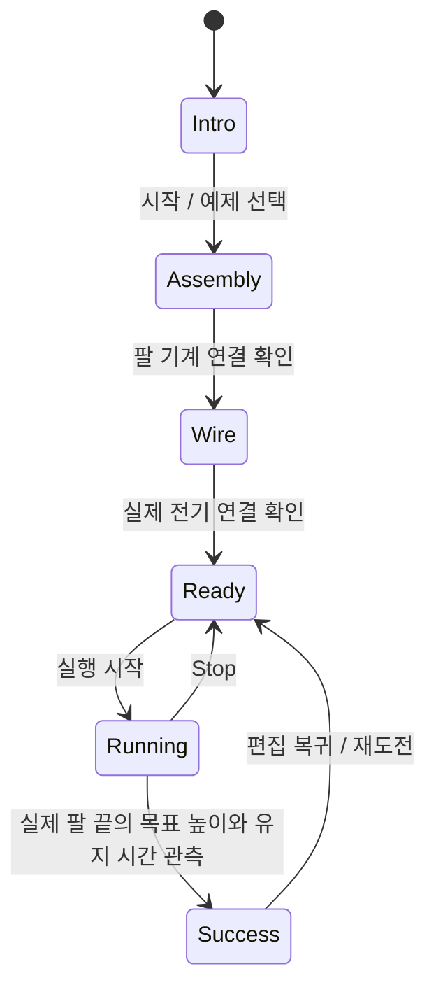
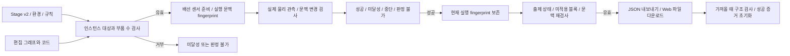

# 실행과 저장 흐름

아래 도식은 [STATUS](STATUS.md)의 통합 소스에 있는 책임과 흐름을 요약해요.

## 구멍에 끼우는 조립

트레이의 `button_down`은 `AssemblyMode.begin_place()`를 불러요. `main.gd._process()`는
GUI가 버튼을 잡고 있는 동안에도 커서 레이를 갱신해요. 레이가 맞은 부품의 빈 호환 기계
포트가 대상이며, 고스트 앵커를 반대 법선으로 정렬한 뒤 대상 법선 축으로 90도씩 돌려요.
빈 곳에서는 부품 바닥을 작업대에 맞추고 10 mm 격자에 놓아요.

짧은 트레이 클릭은 다음 3D 클릭까지 고스트를 유지해요. 끌어서 3D 위에서 놓거나 다음
클릭을 하면 확정하고, 트레이로 끌어 놓거나 우클릭/Esc를 누르면 취소해요. 놓인 부품을
4 px 넘게 끌면 `begin_move()`가 기계 링크만 풀어요. 배선은 유지하며 취소는 원래 배치와
링크를 복원해요. 새 부품과 0.5 mm 이내의 모든 빈 호환 반대 법선 포트 링크는 한 Undo로
묶어요. 충돌 상자 침범이나 링크 한도 초과 시 확정하지 않아요.

`PortIndicators`는 그래프에서 빈 기계 구멍 링과 링크당 볼트 머리를 파생해요. 끼우기 중에는
모든 부품의 빈 구멍, 평소에는 선택 부품의 빈 구멍만 보여요. 실행 시 링은 숨기고 볼트는
실제 몸체 변환을 따라가요. 기존 G/R/숫자 편집은 고급 조작 경로로 유지해요.
명세와 M2 제외 범위는 [모듈형 조립](design/modular-build.md), 결정은 [ADR 0039](adr/0039-hole-targeted-snap-building.md)예요.

## 코드 실행과 제어권

`scenes/main.gd`가 실행 버튼과 제어권을 조정하고 `MiniRuntime`이 명령을 해석해요. 코드 종료와 임무 성공은 다른 사건이에요. Stop은 VM을 중단하고 DC 모터를 정지하고 LED를 끄며 서보의 마지막 목표를 유지해요. 진행 중 Stage 시도는 cancelled로 기록해요. 물리 정지나 초기 자세 복원으로 해석하지 않아요. 편집 모드 복귀는 `RunMode.teardown()` 뒤 원본 그래프를 다시 보여줘요.

전기 단계는 `RunMode.power_tier`예요([ADR 0040](adr/0040-tier-1-electrical-power.md)). 자유 제작은 단계 1이고,
스테이지는 레벨의 `power_tier`(기본 0), 배터리가 없는 예제·저장본은 전원 부품을 넣기 전까지 단계 0이에요.
실행 모드에 들어갈 때 `PowerNet`이 전원 케이블을 따라 각 부품에 전원이 오는지 계산해요. 전원이 없는
모터와 서보는 명령을 무시해요. Run을 누르면 고칠 순서대로 첫 문제(배터리 없음, 스위치 꺼짐, 전원 미연결,
앞 부품에 전원 없음)를 보여 주고, 보드에 전원이 없으면 프로그램을 시작하지 않아요. 배선 탭의 배터리
스위치를 실행 중에 끄면 프로그램을 멈추고 모터를 정지해요. 단계 0은 이전과 같이 항상 전원이 있는 것으로 봐요.

VM은 틱당 128개 연산과 실행 전체 10,000회 루프 진입, 시뮬레이션/실시간 각 60초를
제한해요. `for range`의 경계는 진입할 때 한 번만 계산하고 리스트를 만들지 않아요.
한계 초과는 실패로 전달하고 DC 모터를 제동하고 LED를 꺼요. 반복 중 Stop은 기존 실행 ID 규칙으로
취소해요. 수동 힌지는 그래프 회전 링크에서 제한 관절만 생성하며 서보 매핑에 넣지 않아요.

B-2에서 `LineSensor(pin).value()/is_dark()`는 아래 방향 실제 레이와 표면 재질의 밝기를
읽어요(0=검정, 1023=흰색, 경계 512; 보드 공통). `Button(pin).is_pressed()`는 버튼 전면
충돌만 읽고, 해제 디바운스는 50 ms예요. `LED(pin).on()/off()/set(0..1)`은 인스턴스별
발광 재질을 바꾸며 Stop 뒤 이전 VM 작업이 다시 켜지지 않아요. 새 장치도 전체 소스의
그래프 배선 사전 검사와 기존 블록 왕복 경로를 써요. 기어는 API 없이 물리 구속으로 작동해요.
`cup_object_count()`는 컵 방향·내부 경계에 든 `environment_role="object"` 자유 환경 물체만 관측하는 런타임 함수이며
D-2의 Stage v2 `cup_count` 전체 대상 규칙이 같은 함수를 읽어요. 로봇/구조 부품·컵과 기계적으로 연결된 물체는 제외하고, 병합 몸체는 한 번만 세어요. [B-2 검증](evidence/parts_pack_v1_2026-10-22/README.md).

## 로컬 초안의 카메라·행동 제어권

`main.gd._build_agent_tools()`가 `AgentCameraLoop`, Claude 작성 `AgentTracePanel`, 선택적
`AgentDesktopBridge`를 연결해요. AI Enable은 기존 VM/수동/동작 프로그램을 멈춘 뒤 그래프의
차 몸체와 배선 모터 두 개를 확인해요. 물리 정지 확인 → 실제 렌더 캡처 → ready → 현재 프레임에
묶인 유한 행동 → 브레이크 → 실제 정지 확인 순서이며, 다음 행동 전에 다시 관측해요.
프레임은 episode/body instance/revision/generation과 PNG 해시에 묶여요. 에디터 카메라는 입력이 아니에요.
AI가 판단하는 동안에는 실제 바퀴 속도를 피드백한 제한 PI 브레이크가 기존 배선 모터로
느린 밀림을 억제해요. 모터 토크·몸체 위치·물리 시간은 바꾸지 않아요. 카메라 준비 조건은
12틱 연속 차체 속도≤0.001m/s·바퀴≤0.05rad/s로 강화했고, 독립 성공 판정 기준은 유지해요.
Stop/문맥 변경은 이 브레이크 제어도 해제하고 기존 zero-duty 정지로 돌아가요.

로컬 Stop, 코드 실행, 그래프/소스/모드 변경, 주요 대화창 열기, 타임아웃과 pending 연결 끊김은
generation을 바꾸고 기존 명령을 폐기해요. Stop은 앱의 `_on_stop_pressed()`를 공유해요.
전체 물리 일시정지나 몸체 위치 덮어쓰기를 하지 않아요. 외부 CLI/MCP는 이 열린 데스크톱에만
접속하고 앱은 제공자 모델을 호출하지 않아요. 기존 코드 실행·저장·Stage 판정 도식의 책임은 유지해요.
계약과 검증은 [APP_CONTROL_API](APP_CONTROL_API.md), [ADR 0029](adr/0029-rendered-desktop-agent-camera-loop.md)예요.

외부 `run_goal.py`는 기존 Codex ChatGPT 로그인으로 요청 모델 Astra를 MCP에 직접 연결해요.
`observe(PNG) → decide(해시·공개 요약·유한 행동) → 실측 정지 → observe`를 한도 안에서 반복하고
마지막 재관측 뒤 Stop으로 끝내요. `DesktopGoalSession`이 episode/revision/generation을 고정하고
영상·행동·시간 한도를 검사하며 실행 오류/EOF는 닫힌 세션으로 끝내요. 실행기는 별도 읽기 전용
describe 연결로 사람 Stop을 감시해요. 감시 요청이 먼저 도착했을 때 작은 AI 요청 한 개를 최대5초
별도 대기시킨 뒤 일반 검증 경로에서 한 번 실행해요. 실행 중인 작업에는 busy로 응답하며,
대기 요청은 Stop 전용 통신 경로를 차지하지 않아요. Stop 뒤에는 이전 문맥 검사가 거절해요.
실행기·MCP 세션의 종료 정리는 같은 episode/revision/generation을 가진 제어권에만 Stop을 보내요.
앱이 이미 다른 문맥이면 새 실행을 그대로 두고 이전 제어권 해제를 확인해요. 첫 관측 요청 전에
문맥을 고정하며 아직 고정하지 않은 세션 종료는 앱을 중단하지 않아요. 수동 Stop은 전체 중단이에요.
이전 코드/저장/Stage 도식의 호출은 바뀌지 않았어요.

후속 로컬 초안에서는 명시적으로 켠 `run_operator.py`가 연결된 동안 AI 탭의 목표 Run 클릭을
`AgentGoalInbox`에 한 번 큐잉해요. 앱이 코드/수동 제어를 종료하고 새 카메라 episode를 만든 뒤
목표와 revision/generation을 고정해요. ready일 때 operator_poll이 한 번 claim하며 부모·실행기
사전 검사·첫 MCP 영상부터 같은 문맥을 검사해요. Stop→Enable 사이에 남은 목표가 새 실행으로
넘어가지 않아요. Stop/fault/문맥 변경은 즉시 큐를 지워요. 제공자 호출은 계속 외부 foreground이고
한 작업 뒤 종료해요. Web/Stage 도식과 프로젝트 저장에는 operator/목표/로그인을 넣지 않아요.

## 저장과 가져오기

각 화살표는 책임 간 논리 호출을 요약해요. 거부 경로에서는 이후 저장/교체 호출을 하지 않아요. 저장 중인 그래프는 편집 원본이며 현재 강체 위치가 아니에요.

## 화면 흐름과 스테이지 레벨

[app.gd](../scenes/app.gd)는 타이틀 → 스테이지 선택 → 로딩 → 새 작업실을 연결해요.
스테이지 선택에는 생성 이미지(`assets/stages/art`)·난이도·배우는 것을 담은 카드와 Lab 카드가 있어요. `stage`는 기존
[StageLevels](../src/core/stage_levels.gd)의 레벨 씬으로 기본 바닥을 바꿔요.
[StageHud](../src/ui/stage_hud.gd)는 중앙 진입 팝업 없이 목표·조립/배선/코드/실행 칩과
현재 단계 힌트를 두 줄 스트립에 보여줘요. 첫 줄에는 도움과 실행/재설정만 있고, 단계 칩이 부품 트레이와 프로그램 패널을 여닫아요.
[ADR 0032](adr/0032-compact-workshop-presentation.md)에 따라 폭이 부족하면 힌트를 먼저 숨기고,
칩은 아이콘/상태와 툴팁으로 줄여요. 도구 이름은 전체 표시 또는 아이콘으로 바뀌며, 주요 버튼은
코드 탭과 구분되는 기존 `Run` 번역을 써요. 편집 패널은 스트립 아래부터 창 아래까지 좌우 가장자리에 붙고 내부 스크롤로 접근해요.
[ADR 0041](adr/0041-docked-panels-and-picture-stage-cards.md)에 따라 폭 1280px부터 트레이와 프로그램 패널을 함께 열 수 있고,
단계가 바뀌어도 패널은 첫 화면 이후 스스로 열리거나 닫히지 않아요. `T`/`N`은 트레이/프로그램 패널, `H`는 패널을 모두 숨기는
감상 보기예요. 실행하면 패널이 숨고 멈추면 이전 상태로 돌아와요. 카메라는 불러오기·창 크기 변경·맞춤 버튼에서만 다시 잡고,
패널이 만들고 있는 로봇을 가릴 때만 예외로 다시 잡아요. 새로 놓는 납작한 부품은 작업대에 눕혀 놓여요.
자유 제작은 코드·블록·배선 탭만 보이고 조종 안내·스테이지·AI는 도움 메뉴에서 열어요.
부품 트레이는 종류별 제목 아래 그림 타일(한 줄 3개)로 나오고, 그림은 실제 메시에서 뽑아요. 블록은 종류를 나타내는 색 띠가 있는 카드로 그려요.
어두운 테마는 배경만 어둡게 그리고 금속 부품이 비추는 하늘은 밝게 유지해요.
가리키거나 초점을 둔 부품은 카드(그림·이름·실제 제품·정격·출처)가 트레이 아래에 나와요([ADR 0042](adr/0042-tray-pictures-and-part-cards.md)).
배선 탭의 첫 메뉴에는 아직 잇지 않은 포트만(신호 먼저, 전기 단계 1부터 전원 포함) 나오고 포트는 "전원", "핀 0"처럼 읽는 이름으로 보여요.
이은 선은 한 줄씩 끊기 버튼과 함께 나오며, 단계 1부터는 아직 전원이 없는 부품을 알려 줘요. 전원 문제 문구는 배선을 바꾸면 지워져요.
[ADR 0034](adr/0034-correct-workshop-type-roles.md)에 따라 목표 문장 28px·분류 태그 회색 14px, 칩/힌트 16/14px을 써요.
편집·도움 패널 제목은 16px 굵게, 결과 제목은 28px이며 공간이 부족한 목표는 축소 없이 생략/전체 툴팁을 유지해요.
[WorkshopGuide](../src/ui/workshop_guide.gd)가 그래프·실제 배선·코드/블록 유효성·실행 모드를
읽어 체크와 자동 패널 열림을 정해요. 사용자가 접은 패널은 단계가 바뀔 때까지 유지돼요.
[StageGoalDisplay](../src/ui/stage_goal_display.gd)는 목표선/결승선/정지 구역의 월드 앵커를 UI 라벨과 리더 선으로 투영해요.
[ADR 0033](adr/0033-goal-label-space-and-observation-states.md)에 따라 줄바꿈 없이 내용의 자연 폭과 배율별 최소 260px을 유지해요.
화면 밖 앵커는 가장자리에 고정하며, 패널·스트립을 뺀 영역의 폭이나 높이가 부족하면 라벨·리더 선을 숨겨요.
그동안 스트립 힌트 자리에 첫 규칙의 현재 값/목표 한 줄 요약과 전체 규칙 툴팁을 표시하며, 수정 가능한 오류를 우선해요.
공간이 복구되면 라벨과 원래 힌트도 돌아와요. 관측 전에는 규칙당 목표 한 줄, 샘플이 들어온 뒤에는
현재 값·목표와 유지 시간 두 줄을 표시해요. 조립 자세는 관측으로 취급하지 않으며 결과는 기존 판정기에서만 와요.
[WorkshopFraming](../src/ui/workshop_framing.gd)은 그래프 메시와 레벨의 목표 표시 AABB를 합쳐 패널을 뺀 화면에 맞춰요.
진입/재시도/예제 불러오기에 적용하고, 사용자 카메라 조작 뒤에는 자동 프레이밍을 중단해요.
Lab 도움 메뉴에서 예제·직접 팔 조립·설정·프로젝트·튜토리얼을 열어요. 예제 교체는 기존 확인 절차를 거쳐요.
스테이지의 답지는 별도 목표 스트립 메뉴에서 확인 후 불러오고 목표를 유지해요. Lab 출제는 남겨요.
`example`과 세션 없는 직접 `main.tscn` 진입은 기존 도구 구성을 유지해요.
웹 검사의 `?ssok_workshop=1` / `?ssok_verify=1` 직접 진입도 유지해요.
레벨 씬 생성/에디터 조정은 [ADR 0028](adr/0028-game-screen-flow-and-stage-levels.md),
바뀐 표시 계약은 [ADR 0030](adr/0030-scene-first-workshop-guidance.md)과 [0031](adr/0031-workshop-presentation-corrections.md)이에요.

## 깃발 임무

이것은 대표 경로예요. 그래프를 관찰해 기계 연결이 없어지면 Assembly, 배선이 없어지면 Wire로 돌아가는 경로가 모든 관련 상태에 추가돼요. 실제 전이는 [FlagMission._build_chart](../src/ui/flag_mission.gd), 실제 판정은 `_observed_flag_raised()`를 확인해요. 정확한 높이·유지 조건은 [FLAG_MISSION](FLAG_MISSION.md)에 있어요. 깃발 완료가 학습 효과나 다른 로봇의 성공을 인증하지 않아요. 세션 작업실에서는 옛 깃발 패널과 팔에 따라다니는 장식 깃발을 숨겨요. 이 절은 유지한 독립 튜토리얼 경로예요. 스테이지는 별도 과제 깃발 부품과 StageEvaluator를 사용해요.

## Stage 판정과 공유

목표·그래프·코드·센서 조건 변경은 이전 성공 증거를 무효화해요. 편집 모드 복귀만으로 성공 증거를 지우지는 않아요. Stage의 센서는 학습 코드가 직접 읽지 않아도 그래프 배선에서 준비한 뒤 실행 문맥을 고정해요. 누락·중복·교체 대상, 센서/물리 오류는 판정 불가, 시간초과·프로그램 오류는 미달성, 사용자 중단은 cancelled예요. 종료한 시도의 늦은 결과는 적용하지 않아요. 범위 밖 초음파는 null 관측으로 계속 실행해요.

규칙은 선언형 수치이며 임의 판정 코드를 실행하지 않아요. 코드 종료 후에도 물리 목표 관측은 가장 긴 유지 시간 + 1.5초 동안 계속되고, 그때까지 목표에 닿지 않으면 `not_met`/`program_finished`로 끝나요(스테이지 세션, ADR 0028). 프로그램 오류/중단은 시도를 종료해요. 실패 이유와 복구 행동은 과제 패널과 공통 상태 표시줄에 나타나요. 서버 공유·계정·검증 서명은 미구현이에요. [계약 상세](STAGE_CONTRACTS.md)를 함께 읽어요.

## 소스와 확인할 검사

[main.gd](../scenes/main.gd), [MiniRuntime](../src/runtime/mini_runtime.gd), [RunMode](../src/runtime/run_mode.gd), [BlockProgramPanel](../src/ui/block_program_panel.gd), [ProjectPanel](../src/ui/project_panel.gd), [FlagMission](../src/ui/flag_mission.gd)가 근거예요. 검사는 [core_authoring](../tests/core_authoring_check.gd), [control_flow](../tests/control_flow_check.gd), [flag_mission](../tests/flag_mission_check.gd)를 작업 범위에 맞춰 실행해요. Stage 관련 검사는 `stage_contract_check`, `stage_authoring_check`, `stage_ui_check`, `sonar_stage_check`, 화면 흐름은 `game_flow_check`예요. 실제 통합 결과는 [증거](evidence/merge_2026-09-30/README.md)에 기록해요.

## 설정과 언어 전환

톱니바퀴 → 수동 입력 중립화·조립/카메라 입력 정지 → 설정 창 → 검증된 선호 변경 → 공유 Theme/기존 override 갱신 → 로컬 저장·결과 안내 → Esc/닫기 → 수동 입력 사용 가능 상태 복원·톱니바퀴 포커스 복귀예요. 실행 VM과 물리는 유지해요. 언어는 원문 키를 가진 기존 컨트롤을 다시 번역하며 블록 카드를 재생성하지 않아요. 화면 글자와 코드 글자 배율은 독립적이에요. [설정 계약](INTERFACE_PREFERENCES.md)과 ADR 0026을 함께 확인해요. 기존 실행·Stop·깃발 상태 전이는 그대로예요.

## 2026-10-22 빈 작업대 스테이지

진입은 레벨 환경 설치 → 스테이지별 저장 복원(없으면 빈 그래프/코드) → 공통 키트 부품 트레이와 조립 칩이에요.
조립·배선·코드·실행 도구를 계속 열 수 있고, A-5 목표 스트립/접이식 도구/글꼴 위계는 유지해요.
답지 메뉴 → 덮어쓰기 확인 → author_solution 그래프/코드 + 과제 깃발 → 답지 사용 상태 저장 순서예요.
lower_arm 보정은 이 답지 로드에만 적용해요. 처음부터 만들기도 확인 뒤 빈 그래프/코드로 돌아가요.
Back/list/next → 초안 확인 → StageProgress 작업 저장 → 라우팅이며, 저장 실패면 현재 편집기에 남아요.

깃발은 종류별 최고 높이 0.155 m를 1초, 결승선은 모든 로봇 부품 경계의 최소 X가 0.5 m 이상인지 봐요.
벽 앞 정지는 환경 벽과의 최소 경계 거리 0.05~0.10 m, 최대 선속도 0.015 m/s 이하 0.3초, 실제 접촉 이력 없음이에요.
센서/서보/섀시 종류나 upright를 성공 전제에 넣지 않아요. 기존 명시적 부품 규칙/초음파 규칙은 가져온 과제에서 계속 유효해요.
새 규칙·집합 선택·진행 저장은 [ADR 0036](adr/0036-own-build-stages-and-aggregate-goals.md), 현재 검증은 [작업 D](WORK_SUMMARY_D.md)예요.

M2 트레이는 `PartTray`의 허용 목록만 순서대로 구성해요. 탭은 전체/구조/움직임/전자/센서/환경이고,
검색과 탭 및 `level.parts` 제한을 함께 적용해요. 빈 `level.parts`는 공통 48종 전체를 허용해요.
`_setup_scene_ui()`를 다시 호출해도 숨긴 카탈로그 부품을 되살리지 않아요.
카탈로그 로더와 `MotionSnapshot`은 전체 정의를 계속 읽으므로 옛 저장 파일·프리셋을 복원할 수 있어요.
트레이 밖의 정의도 작업실이 참조를 유지해 revision 검사 때 숨긴 메쉬를 반복 로드하지 않아요.

깃발·결승선의 `author_solution`은 `KitFlagArmPreset` 또는 `KitCarPreset`의 그래프예요.
M2d의 벽 답지만 키트 회귀가 해결될 때까지 `RobotCarPreset.build(0.8)`을 임시로 사용해요.
원래 키트 `scene`, 48종 트레이·답지 코드·목표 기준은 유지하고 예외는 벽 답지 그래프 하나예요.
차의 판·빔·장치는 키트 구멍, 바퀴는 모터 축으로 연결하고 배선은 기존 차 답지와 같아요.
깃발 팔은 판·추·서보·빔·깃발을 연결해요. `StageLevels.starting_graph()`는 새 출력축을 기준으로
답지의 팔을 내리며 편집 그래프나 실행 물리 규칙을 바꾸지 않아요.
답지 코드·목표 기준은 유지하고 형상·배치의 실제 결과는 [M2 요약](WORK_SUMMARY_M2.md)에 기록해요.
팔 내림 부호는 기존 `actuator_drives_connected_body` 방향에 맞춰 골라 0도는 낮고 90도는 높게 해요.
옛 깃발 연습은 `FlagMission.begin_practice()`로 시작해 이전 답지에 `arm_link`가 있었는지와 무관하게
느슨한 팔 연결 → 배선 → 관측 흐름으로 들어가요.
